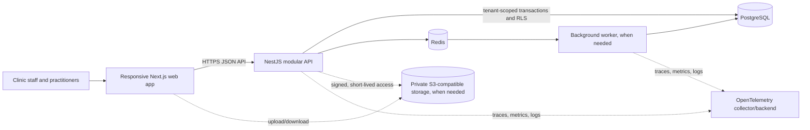
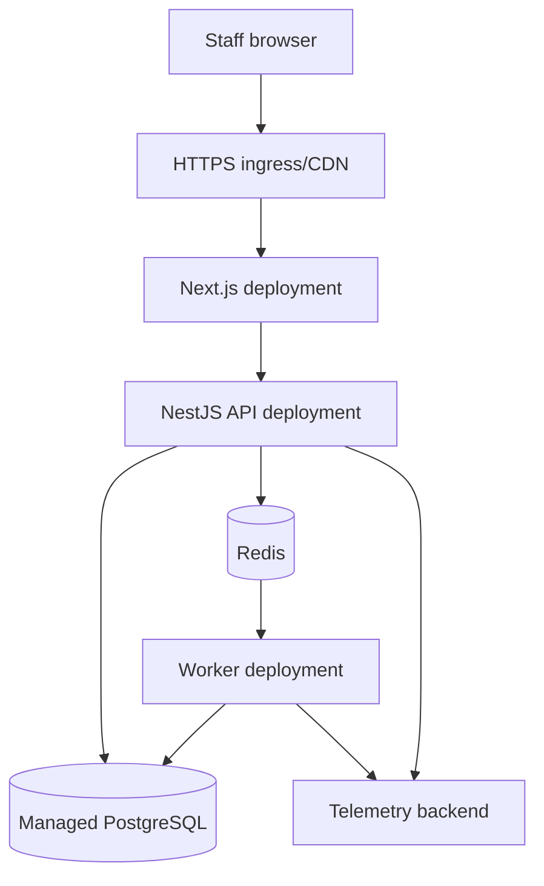

# PhysioNG High-Level Design (HLD)

**Version:** 1.0  
**Status:** Initial MVP architecture proposal  
**Audience:** Product, engineering, security, and operations

## 1. Purpose and scope

This document describes the system boundaries, major components, data flow, and key architecture decisions for the PhysioNG MVP. It turns the product [blueprint](../product/implementation-blueprint.md) and [MVP scope](../../MVP_README.md) into an implementation-level architecture direction. Detailed module, API, data, and transaction behavior is in the [Low-Level Design](low-level-design.md).

The first release serves physiotherapy clinics with a responsive staff-facing web application. It supports tenant onboarding, identity and membership, patient records and consent, practitioners, scheduling, encounters, clinical notes, treatment plans, and exercise prescriptions.

## 2. Design goals

- Enforce tenant isolation at the API and PostgreSQL layers.
- Keep clinical data attributable, auditable, and accessible only to authorized care-team members.
- Support the complete clinic workflow without requiring multiple applications.
- Keep domain boundaries clear inside a modular monolith.
- Allow international locale and tenant configuration without assuming one country.
- Provide a practical path to scale and extract services later without designing for hypothetical microservice needs now.

## 3. Out of scope

The MVP does not include hospital IPD, admissions/bed management, separate portals, patient self-service, payment processing, insurance claims, inventory, AI-generated clinical content, or microservices. These remain future product tracks.

## 4. System context

PostgreSQL is the transactional source of truth. Redis is for cache/queue use only and must not become the source of truth for authorization or clinical records. Clinical file storage is introduced only when the MVP has a concrete attachment workflow; objects remain private and tenant-authorized.

## 5. Major components

| Component | Responsibility | Initial boundary |
| --- | --- | --- |
| Next.js web app | Responsive UI, authentication screens, tenant-aware navigation, clinic workflows | One app with role-based layouts |
| NestJS API | Authentication integration, authorization, domain workflows, validation, transactions, audit events | One deployable modular monolith |
| Identity and access | User identity, memberships, roles, permissions, sessions | Domain module; identity provider is an implementation decision |
| Clinic domains | Organizations, branches, practitioners, patients, scheduling, clinical records | NestJS modules with explicit ownership |
| PostgreSQL | Durable tenant-owned records, constraints, migrations, RLS | Shared database/schema initially |
| Redis | Cache and asynchronous job broker | Optional for synchronous MVP flows; no security state authority |
| Worker process | Emails/notifications and retryable background work | Separate process only when jobs are introduced |
| Object storage | Clinical attachments and generated exports | Deferred; private bucket and tenant-scoped access |
| Observability | Correlated logs, metrics, traces, errors | OpenTelemetry-compatible instrumentation |

## 6. Logical domain boundaries

- **Identity:** user identity, sessions, memberships, roles, permissions.
- **Tenancy and organization:** tenants, organizations, branches, tenant configuration.
- **Practitioners:** practitioner profile and branch assignment.
- **Patients:** patient demographics, contacts, consent, and medical history.
- **Scheduling:** practitioner availability, rooms, appointments, booking conflicts.
- **Clinical records:** encounters, assessments, diagnoses, notes, treatment plans, exercise prescriptions, and outcomes.
- **Audit:** append-oriented security and clinical activity records.
- **Platform operations:** notifications, reports, integrations (later as needed).

Each module owns its business rules and persistence access. Cross-domain operations go through module services/use cases rather than importing another module's repositories directly.

## 7. Key request and data flows

### Authenticated tenant request

1. The user signs in through the selected identity mechanism.
2. The web app sends a short-lived credential over HTTPS to the API.
3. The API validates identity, loads active memberships/permissions from trusted server-side data, and resolves the requested tenant against those memberships.
4. The API starts a database transaction and sets tenant/user context transaction-locally for RLS policies.
5. Domain services validate role/resource permissions and execute tenant-scoped operations.
6. Security-sensitive changes and clinical access/mutations emit attributable audit events in the same transaction where practical.
7. The API returns only data authorized for the resolved tenant and resource scope.

Client-supplied `tenant_id` is a selector only. It is never proof of membership or authorization. Context must be reset automatically at transaction end so pooled connections cannot leak tenant identity.

### Appointment-to-encounter flow

1. Staff selects a patient and an available practitioner slot.
2. The API validates patient, branch, practitioner, and appointment permissions under the active tenant.
3. Scheduling checks availability and persists the appointment atomically with conflict prevention.
4. At check-in, an authorized practitioner starts an encounter linked to the patient and optionally the appointment.
5. Assessment, diagnosis, treatment, notes, and follow-up plan are validated and persisted with author/time attribution.
6. Updates preserve history according to the clinical correction policy; deletion of finalized clinical entries is restricted.

## 8. Tenancy and data isolation

- Shared PostgreSQL database and schema initially; every tenant-owned entity carries `tenant_id`.
- Active tenant context is derived server-side from authenticated identity and membership.
- PostgreSQL RLS is enabled and forced on tenant-owned tables where supported by the operational role model.
- Every repository query is tenant-aware; RLS is defense in depth, not a substitute for correct application authorization.
- Foreign keys and unique constraints include tenant scope when required to prevent cross-tenant references.
- Migration, seed, worker, and admin roles use separate least-privilege database credentials.
- Background jobs carry an immutable tenant identifier and revalidate the tenant before processing.
- Automated integration tests exercise cross-tenant reads, writes, joins, exports, and identifier guessing.

## 9. Security, privacy, and audit

- HTTPS at every external boundary; encryption at rest configured for managed database, backups, and object storage.
- RBAC plus resource-level checks on every protected operation.
- MFA required for privileged roles before production release.
- Passwords/identity secrets handled by a reviewed identity solution; tokens and secrets never logged.
- Clinical records are private by default; access is limited by tenant, role, and care-workflow permissions.
- Audit records identify actor, tenant, action, resource, timestamp, and request/correlation id; avoid storing unnecessary clinical payloads in audit metadata.
- Consent state and changes are recorded with who/when/source; consent withdrawal behavior is defined before production.
- Data retention, export, deletion/correction, backup, restore, and incident procedures are jurisdiction-aware operational work.
- Security controls do not themselves assert DPDP, GDPR, HIPAA, or other certification.

## 10. Deployment view

Initial deployment consists of the web app, API, PostgreSQL, and Redis where queue/cache needs exist. Worker deployment is added for retryable jobs. Environments are separated (local, preview/staging, production), each with scoped credentials and isolated data. Database migrations run as a controlled release step using a dedicated role. Production database and backups are not exposed to the public network.

## 11. Quality attributes

- **Security:** tenant isolation, least privilege, auditability, and tested authorization.
- **Availability:** health checks, bounded retries, database backups, and documented recovery objectives set before production.
- **Performance:** paginate lists, index tenant-scoped access paths, and measure real clinic workflows before tuning.
- **Maintainability:** domain module ownership, API contracts, migrations, and reviewable changes.
- **Portability:** locale/timezone/currency configuration; avoid embedding India-specific assumptions in core models.
- **Accessibility:** keyboard-operable workflows, semantic controls, clear validation, and responsive layouts.

## 12. Architecture decisions and open questions

| Decision | Current direction | Open implementation detail |
| --- | --- | --- |
| Application shape | Modular monolith | Module dependency checks and deployment topology |
| API | NestJS JSON API | Versioning, error envelope, and authentication mechanism |
| Data | PostgreSQL shared schema with RLS | Migration tooling, runtime roles, policy helper functions |
| Tenant model | Tenant + organization + branch | Whether multiple organizations can share a tenant in first release |
| Identity | Server-validated identity and membership | Select provider/session model before implementation |
| Scheduling | Transactional conflict prevention | Slot granularity, timezone policy, recurrence rules |
| Clinical history | Attributable and traceable changes | Finalized note correction/amendment workflow |
| Files | Private object storage when needed | Provider, encryption/key policy, malware scanning, retention |
| Compliance | Jurisdiction-specific review | Target countries and contracted deployment requirements |

